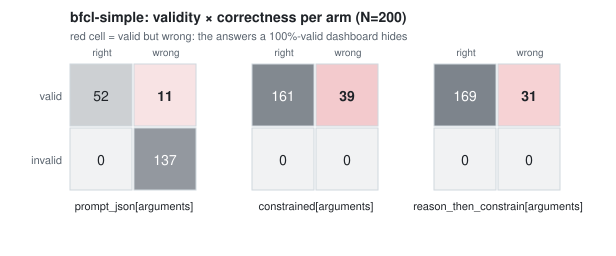
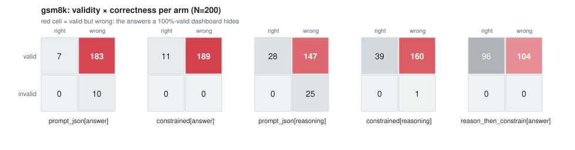

# validbutwrong



**Function calling (BFCL, N=200): turning on a JSON-Schema grammar raised Qwen2.5-0.5B's AST-match accuracy by +54.5 pts [95% CI +47.5, +61.5] *and* raised its wrong-but-valid rate by +14.0 pts [+9.0, +19.5].** 29 outputs that were visibly broken without the grammar became well-formed wrong calls. Same model, same prompt; only the grammar was toggled.

**Grade-school math (GSM8K, N=200), same model, same toggle: no detectable effect on accuracy** (95% CI [−0.5, +5.0] pts). Validity level says little about accuracy: GSM8K's answer-only `constrained` arm is 100% valid at 5.5% accuracy (94.5% wrong-but-valid), and on BFCL 29 of the 137 outputs the grammar made valid are wrong. Only the per-item ledger separates them.

`validbutwrong` drives a real constrained-decoding backend (outlines' JSON-Schema → token-FSM logits processor, or llama.cpp's native GBNF grammar, on one llama.cpp runtime). It runs the **same model on the same items** through four decoding arms and reports schema validity, answer accuracy and the wrong-but-valid rate **separately**, with a per-item transition ledger and an exit code for CI. It measures what a grammar costs, *or buys*, on your task. It does not tell you whether constraints are good.

```bash
pip install validbutwrong
validbutwrong run     # re-scores BOTH committed replays (BFCL, then GSM8K; N=200 each) in seconds, with no model download
```

Every result in the demo tables and charts is **replayed**: generated once on CPU and committed. Regenerating is opt-in, with `--live` (cost below).

---

## What the demos show

Qwen2.5-0.5B-Instruct (Q4_K_M GGUF), greedy decoding. 95% paired-bootstrap CIs, 2,000 resamples, seed 42. The **headline comparison toggles only the grammar at a fixed output contract** (`prompt_json[S]` → `constrained[S]`: same prompt, grammar off vs on).

### Function calling: BFCL v3 `simple`, first 200 items

The model emits a function call's arguments. Scored by AST match against BFCL's `possible_answer`, never by execution.

| arm | schema validity | AST-match accuracy | wrong-but-valid |
|---|---|---|---|
| `unconstrained` (Python-syntax call, parsed) | n/a | 45.0% [38.0, 51.5] | n/a |
| `prompt_json[arguments]`: JSON asked for, no grammar | 31.5% [25.5, 37.5] | 26.0% [20.5, 32.0] | 5.5% [2.5, 9.0] |
| `constrained[arguments]`: same prompt, grammar on | 100.0% | 80.5% [75.0, 85.5] | 19.5% [14.5, 25.0] |
| `reason_then_constrain[arguments]` | 100.0% | 84.5% [79.0, 89.0] | 15.5% [11.0, 21.0] |

- Grammar on, same contract: AST accuracy +54.5 pts [+47.5, +61.5] (110 items wrong→right, 1 right→wrong). Without the grammar, 137 of 200 `prompt_json` outputs are invalid, and 129 of those echo the schema's own structure back (a top-level `"properties"` or `"type": "object"`) instead of filling it in.
- In the same comparison, the wrong-but-valid rate rises +14.0 pts [+9.0, +19.5]. Per item: 108 broken outputs became right, but 29 broken outputs became well-formed *wrong* calls, and 1 right call became wrong (9 were valid-but-wrong either way).
- Secondary (confounded) comparison against the free-text baseline, a Python-syntax call with no JSON contract: `unconstrained` → `constrained` is +35.5 pts [+27.5, +43.5] (84 wrong→right, 13 right→wrong). It is smaller than the headline because the `prompt_json` baseline fails mostly by echoing the schema. The constraint is net-positive here *and* moves some failures out of sight of a validity check. That second effect is why the tool reports the red cell separately.

### Grade-school math: GSM8K, first 200 test problems



| arm | schema validity | answer accuracy | wrong-but-valid |
|---|---|---|---|
| `unconstrained` (free text, answer parsed) | n/a | 47.0% [40.0, 54.0] | n/a |
| `prompt_json[answer]`: JSON asked for, no grammar | 95.0% [92.0, 98.0] | 3.5% [1.0, 6.5] | 91.5% [87.5, 95.0] |
| `constrained[answer]`: same prompt, grammar on | 100.0% | 5.5% [2.5, 9.0] | 94.5% [91.0, 97.5] |
| `prompt_json[reasoning]`: `{"reasoning", "answer"}`, no grammar | 87.5% [82.5, 92.0] | 14.0% [9.0, 19.0] | 73.5% [67.5, 79.5] |
| `constrained[reasoning]`: same, grammar on | 99.5% [98.5, 100.0] | 19.5% [14.0, 25.0] | 80.0% [74.5, 85.5] |
| `reason_then_constrain[answer]`: reason freely, then constrained packaging | 100.0% | 48.0% [41.0, 55.0] | 52.0% [45.0, 59.0] |

- Grammar on, same contract: validity rises (+5.0 pts [+2.0, +8.0]; with a reasoning field +12.0 pts [+7.5, +16.5]). No detectable effect on accuracy at N=200 (answer-only [−0.5, +5.0] pts; reasoning field [+0.0, +10.5] pts).
- The low accuracy of the answer-only arms is already there *without* the grammar (`prompt_json[answer]` 3.5%). So it is not the grammar's effect. Removing room to reason explains part of it (3.5% answer-only vs 14.0% with a reasoning field, both without a grammar), and the JSON contract itself costs more (14.0% vs 47.0% free text).
- Secondary (confounded) comparison: `unconstrained` → answer-only `constrained` is −41.5 pts [−49.5, −33.5] (90 right→wrong, 7 wrong→right). It changes two things at once (no reasoning text *and* a grammar), so the tool reports it but never treats it as the grammar's effect.
- `reason_then_constrain` (reason freely, constrain late) is 48.0%: no detectable difference from free text (0 right→wrong, 2 wrong→right).

On this model and task the GSM8K result is consistent with dottxt's point that the grammar was not the problem (no detectable effect at a fixed contract), and with the near-null fixed-prompt ablation in SOB. It is *not* consistent with dottxt's finding that JSON with a reasoning field matches free text (19.5% vs 47.0% here). It shows no grammar-specific "tax" on this task. BFCL shows the same model with a large effect on a different task. A different model, task or schema can come out differently again; that is the point of measuring.

## Who this is for

When software asks an AI model for an answer in a strict format, like a filled-in form, it can force the model to follow that format exactly. Every answer then arrives neatly formatted, and it is easy to assume that means every answer is right. It doesn't. Forcing the format can change the answers themselves, for better or for worse, and nothing in the formatted output tells you which. This tool is for engineers who build products on AI models that must return structured data. Give it your model, your task and your format. It runs the same questions with and without the format rule and tells you, question by question, which answers stayed right, which went wrong, and how many wrong answers were hidden behind a perfectly valid format.

## How it works

```
task (items, prompts, schema, answer checker)
   │
   ├─ unconstrained ─────────────┐
   ├─ prompt_json[S]  ── no grammar ──┤      one llama.cpp runtime, one GGUF,
   ├─ constrained[S]  ── grammar ─────┤──▶   greedy decoding; the grammar is the
   └─ reason_then_constrain[S*] ──────┘      ONLY thing that differs between pairs
                                   │
               replay file (JSONL: every generation + model sha256, versions, hardware, timings)
                                   │
            score ─▶ validity · accuracy · wrong-but-valid per arm · paired bootstrap CIs
                     per-item ledger · 2×2 quadrants  (executable accuracy: only if a task supplies
                     an execution check; not computed in these demos)
                                   │
               report.json · report.md · quadrants.svg · ledger.csv · exit code
```

Design decisions, and why:

- **Two constraint engines on one runtime.** `--engine outlines` (default) or `--engine llamacpp` (GBNF). Both drive the same `llama_cpp.Llama` object and the same weights, so a speed difference between them is the constraint machinery, not the model runtime. On the tracer item the two produced token-identical text on every arm. On that one tracer item outlines was faster on CPU (16.9 s vs 26.5 s for the GSM8K item), mainly on the long constrained string (3.2 s vs 11.8 s).
- **A canary self-test before every live run.** A constraint can fail *silently*. During development, outlines' logits processor raised an `ImportError` inside llama.cpp's sampler callback. llama.cpp logged "Exception ignored" and carried on generating unconstrained text, which still happened to be valid JSON. Every engine now has to force a constant the model would never write unprompted (`{"canary": "vbw-canary-7f3q"}`) before a run starts. If it can't, the run refuses. A unit test checks that the canary *fails* on an engine that ignores the schema.
- **Property order is part of the contract.** `{"reasoning", "answer"}` must be generated reasoning-first. Sorting schema keys (an easy cache-key habit) silently puts the answer first and removes the reasoning. The engines never sort.
- **Generation and scoring are separate.** Scoring reads only the replay file, so results re-score in seconds without a model, and an extractor fix can be applied and measured after the fact (see Limitations).
- **Rates over all N.** Every metric divides by all items, never by the valid subset, so arms are compared on the same denominator. `unconstrained` has no contract, so its validity is `n/a`, not 0.
- **Nulls are printed as nulls.** A difference whose 95% CI includes 0 is printed as "no detectable effect at N=…" with the interval, never rounded into an effect.

## Use it in CI

```bash
validbutwrong run --task gsm8k --fail-if-wrong-valid-above 0.20   # exit 1 if any constrained[*] arm exceeds 20% (reason_then_constrain is not gated)
```

Exit codes: `0` ok · `1` gate tripped · `2` setup/usage error. The gate is yours to set on your pipeline. The tool has no built-in pass mark.

## Point it at your own task

A task is about 30 lines: items, a free-text prompt, a JSON prompt, a schema, and how to read and check an answer. See [`examples/custom_task.py`](examples/custom_task.py) (exact-match QA over your own JSONL). The arms, canary, metrics and report are reused unchanged.

```bash
pip install 'validbutwrong[live]'
python examples/custom_task.py my_questions.jsonl path/to/any-chat-model.gguf
```

## Inputs and outputs (machine-readable)

```yaml
# INPUT 1 — CLI
command: validbutwrong run [--task all|bfcl-simple|gsm8k] [--live] [--n INT] [--model PATH.gguf]
                           [--engine outlines|llamacpp] [--threads INT] [--replay PATH.jsonl]
                           [--out DIR] [--fail-if-wrong-valid-above RATE]
defaults: {task: all, mode: replay, out: validbutwrong-out, engine: outlines, live_n: 20}
exit_codes: {0: ok, 1: gate tripped, 2: usage or setup error}

# INPUT 2 — your own task (Python): subclass validbutwrong.Task
Task:
  name: str
  correctness_label: str
  schemas: {schema_name: JSONSchema}          # used by prompt_json[S] and constrained[S]
  answer_schema: str                          # schema_name used by reason_then_constrain
  items(n: int|None) -> list[Item]            # Item(id: str, prompt: str, gold: Any, meta: dict)
  free_prompt(item) -> str
  json_prompt(item, schema) -> str
  extract_free(text, item) -> Any|None
  extract_json(obj, item) -> Any|None
  is_correct(answer, item) -> bool
example_row (examples/custom_task.py): {"question": str, "answer": str}

# OUTPUT — per task: report.json, report.md, quadrants.svg, ledger.csv
report.json:
  task: str
  correctness_label: str
  n: int                                      # scored items
  mode: replay|live
  excluded: {n: int, ids: [str], reason: str} # backend could not compile the schema
  meta: {task, n, engine, model_sha256, model_source, versions, hardware, decoding,
         max_tokens, selftest_seconds, started, ended, wall_seconds, wall_clock_seconds}
  arms:
    <arm_key>:                                # unconstrained | prompt_json[S] | constrained[S] | reason_then_constrain[S]
      n: int
      schema_validity: {rate: float, ci95: [lo, hi]} | null   # null for unconstrained
      answer_accuracy: {rate: float, ci95: [lo, hi]}
      wrong_but_valid: {rate: float, ci95: [lo, hi]} | null
      executable_accuracy: null               # not computed in these demos
      quadrant: {valid_right, valid_wrong, invalid_right, invalid_wrong} | null
  comparisons:
    - {from: arm_key, to: arm_key, n: int, role: str,
       deltas: {<metric>: {delta: float, ci95: [lo, hi], excludes_0: bool}},
       transitions: {"<state> -> <state>": int},   # state = valid|invalid|n/a "/" right|wrong
       flips: {right_to_wrong: int, wrong_to_right: int}}
  ledger: [{id: str, <arm_key>: "valid/right" | "valid/wrong" | "invalid/right" | "invalid/wrong" | "n/a/right" | "n/a/wrong"}]
```

## Regenerate the numbers (`--live`)

```bash
pip install 'validbutwrong[live]'
validbutwrong run --live --n 20                 # downloads the pinned GGUF (~491 MB, sha256-checked)
validbutwrong run --live --model my-model.gguf --n 50 --engine llamacpp
```

What `--live` costs: the `[live]` extra (llama-cpp-python, outlines, numba), a one-time ~491 MB model download, and generation time. Measured on the reference CPU (Apple M1, 4 threads, CPU only), every arm included:

| task | mean s/item (median, p90) | `--n 20` (the live default) | items that fit in 10 min | full N=200 |
|---|---|---|---|---|
| `bfcl-simple` | 5.99 (5.42, 8.64) | ≈ 2 min | 104 | 1,201.6 s ≈ 20 min |
| `gsm8k` | 13.86 (13.56, 18.08) | ≈ 6 min | 37 | 2,775.6 s ≈ 46 min |

That is why the default is the committed replay: 37 GSM8K items, the most that fit in a 10-minute live run, are too few for useful intervals. Replays live in `src/validbutwrong/replays/` with the model sha256, backend versions, hardware and timings in their header. Determinism: independent repeat runs produced byte-identical generations (GSM8K, first 24 items: 24/24; BFCL: 192 of 200 items identical across two full runs, and the other 8 are the items the packaging-cap fix below changed on purpose).

CPU-only note: a stock `pip install llama-cpp-python` on macOS builds with Metal force-enabled (`CMakeLists.txt` L129 at v0.3.36 sets `GGML_METAL` ON with `FORCE`, which `CMAKE_ARGS` cannot override). The reference numbers were produced with llama-cpp-python 0.3.36 built from source with that line patched to OFF. On a stock install, timings, and possibly generations, will differ from the committed replay; this was not verified. The canary self-test still checks that the constraint binds.

## Validated examples

```
Dataset: GSM8K, first 200 test problems: github.com/openai/grade-school-math (MIT), commit 3101c7d
Task: answer a grade-school math word problem; schemas {"answer": int} and {"reasoning": str, "answer": int}
Observed pattern: grammar raises validity; no detectable accuracy effect at a fixed contract; (secondary, confounded) removing reasoning AND adding a grammar: −41.5 pts
Recommended method: per-item ledger; headline = prompt_json[S] → constrained[S]
Result: table above (replayed, N=200, seed 42 for the bootstrap)
Reproducible with: validbutwrong run --task gsm8k

Dataset: BFCL v3 "simple": huggingface.co/datasets/gorilla-llm/Berkeley-Function-Calling-Leaderboard (Apache-2.0), revision 61fc060
Task: emit the arguments of one function call; schema = the function's parameters (BFCL types converted to JSON Schema)
Observed pattern: grammar raises AST accuracy +54.5 pts AND raises wrong-but-valid +14.0 pts (a large effect where GSM8K's fixed-contract effect was not detectable)
Recommended method: AST-match accuracy + wrong-but-valid, prompt_json → constrained
Result: table above (replayed, N=200, seed 42 for the bootstrap)
Reproducible with: validbutwrong run --task bfcl-simple   (live, opt-in: validbutwrong run --task bfcl-simple --live --n 200)
```

## Why this exists (and what already does)

The idea is not new, and the tool doesn't claim it is.

- **The phenomenon is named and measured.** arXiv:2605.26128 (*The Constraint Tax*, 2026) reports, on sub-3B models and synthetic tasks, answer accuracy falling 19.7% → 11.0% while validity rose 61.5% → 100.0%. It recommends reporting validity, answer accuracy, executable accuracy and the wrong-valid rate *separately*. It released no code. This tool is that recommendation as a command. It is not a replication: on a model the paper also used (Qwen2.5-0.5B; here Q4_K_M) but on different tasks, a grammar-specific accuracy effect was not detected on GSM8K at N=200. On function calling the paper's direction is the opposite of the BFCL demo: it reports 91.5% executable accuracy with prompt-only JSON vs 48.0% under a hard tool-call schema (Qwen2.5-1.5B).
- **Results go both ways.** JSONSchemaBench's paper (arXiv:2501.10868, §6.2) found that constrained decoding, "regardless of the framework, achieves higher performance than the unconstrained setting" on GSM8K, Last Letters and Shuffle Objects (best ≈ +3%). *Let Me Speak Freely?* (arXiv:2408.02442) and ExtractBench (arXiv:2602.12247, §4.3) report degradation. SOB (arXiv:2604.25359, §6.3) adds schema enforcement at a fixed prompt and finds Value Accuracy "changes only slightly, from −0.007 to +0.033". dottxt's [*Say What You Mean*](https://blog.dottxt.ai/say-what-you-mean.html) argues the degradation comparisons weren't apples-to-apples. CRANE (arXiv:2502.09061) proposes reasoning-augmented constrained decoding within one generation; the two-turn `reason_then_constrain` arm is inspired by it. *Structure Tax* (arXiv:2610.12056, October 2026) attributes the loss to schema design: reasoning-first field order matches or exceeds free-form accuracy, while answer-first order drops steeply, particularly in smaller models. On GSM8K above, reasoning-first JSON beat answer-first (19.5% vs 5.5% under the grammar) but stayed well below free text (47.0%) for this 0.5B model.
- **The ablation exists as study code.** [`appier-research/structure-gen`](https://github.com/appier-research/structure-gen) (the 2408.02442 code, with outlines/xgrammar/TGI backends) and dottxt's [`GSM8K_JSON.ipynb`](https://github.com/dottxt-ai/demos/tree/main/say-what-you-mean) each run it for their own paper on fixed tasks. What this tool adds is the packaging: point it at *your* model, task and schema, get paired per-item flips, separated metrics, a canary-checked constraint and a CI exit code.
- **The common harnesses measure validity, not correctness.** JSONSchemaBench's released harness measures efficiency and coverage (its paper's §6 quality study is not part of the harness); its result type has no field for whether an answer was right (`epfl-dlab/jsonschemabench` `core/types.py:146-166` at `8003e84`). lm-evaluation-harness's `jsonschema_bench` task reports `json_validity` and `schema_compliance`. In vLLM's structured-output serving benchmark, `correct_rate(%)` returns true for any parseable JSON object and never reads `expected` (`benchmarks/benchmark_serving_structured_output.py:708-719` at `276fbcf`). That was reported publicly by `AUTHENSOR` in [vllm#55441](https://github.com/vllm-project/vllm/issues/55441), with a fix by `he-yufeng` in [vllm#55447](https://github.com/vllm-project/vllm/pull/55447), open and unmerged as of 2026-10-11.
- **Not the same "constraint tax":** arXiv:2606.25605 uses the same phrase for a different effect, tool calls being suppressed when `response_format` is set. This tool doesn't measure that.

## When NOT to use this

- To pick the best *model*: it compares decoding arms within one model, not models against each other.
- On tasks without a checkable answer: with no gold, it can only report validity (use JSONSchemaBench for that).
- To get a verdict on constrained decoding in general: one model and task is one data point, as the demo shows.
- For hosted APIs: v0.1 drives local GGUF models (with a chat template in their metadata) through llama.cpp only.
- With only a few dozen items: at the live default (`--n 20`) only large effects are detectable. Plan on ~200 items (≈20–46 min of CPU per task on an M1). Your own task also means writing a small Python `Task` class (see below).

## Limitations (honest)

- **One small model, quantized.** Qwen2.5-0.5B at Q4_K_M (chosen for disk and CPU budget, not fidelity). Larger models or Q8 weights may behave differently.
- **Free-text extraction is a measurement.** The `unconstrained` arm's accuracy depends on parsing the answer out of free text. The parser reads an `Answer:` line, then LaTeX `\boxed{}`, then the last number. **`\boxed{}` support was added after inspecting outputs.** Without it, "\boxed{1400} bananas to last for 2 months" was read as 2. That change moved exactly one item (`gsm8k_test_156`; free-text accuracy 46.5% → 47.0%) and no conclusion.
- **Truncation:** 22 of 200 GSM8K free-text generations hit the 384-token cap and are scored as produced. `reason_then_constrain` reuses the same free-text phase, so it inherits them. The packaging turn's own cap was originally 48 tokens, which cut off 8 long BFCL argument lists mid-JSON. It is now 384, and BFCL was regenerated. The GSM8K replay header still records 48, but its longest packaging output was 13 tokens, so those generations are identical under either cap.
- **Backend schema coverage:** a schema the backend cannot compile is recorded per item as `unsupported_schema`. That item is dropped from every arm (comparisons stay paired) and reported, never scored as a model error. BFCL's `any` type is mapped to an explicit JSON type union so that outlines can compile it; 0 items were excluded in either demo.
- **An integer schema can "rescue" a wrong answer.** Reasoning to 16.5 and then packaging into `{"answer": integer}` yields 16. On `gsm8k_test_143` that matched gold by luck.
- **Executable accuracy is not computed in these demos:** GSM8K has no execution, and BFCL's executable functions aren't in the dataset. The report prints the row as "not computed" (planned for v0.2). BFCL is scored by a *simplified* AST match (it maps positional arguments by declared order, which is more lenient than the official checker, so it is charitable to the free-text baseline). It is not the official BFCL checker.
- **CPU-only reference timings** (see above). The canary proves a constraint binds; it doesn't prove the constraint matches your schema's every feature (unsupported JSON Schema keywords are the backend's responsibility).

## Reproduce everything

```bash
git clone https://github.com/macamiri/validbutwrong && cd validbutwrong
pip install -e '.[live,test]'
pytest                                      # no model needed
validbutwrong run                           # both replays → reports in seconds
validbutwrong run --task gsm8k --live --n 200   # full regeneration (~46 min on an M1, CPU)
```

Data provenance: `src/validbutwrong/data/SOURCES.md`. Model: `Qwen/Qwen2.5-0.5B-Instruct-GGUF` revision `9217f5d`, file `qwen2.5-0.5b-instruct-q4_k_m.gguf`, sha256 `74a4da8c…a7d9db` (Apache-2.0).

Built with assistance from AI coding agents; the architecture, methodology, statistics, and analysis are the author's.

## References

arXiv:2605.26128 · arXiv:2610.12056 · arXiv:2408.02442 · arXiv:2502.09061 · arXiv:2604.25359 · arXiv:2602.12247 · arXiv:2501.10868 · arXiv:2407.09141 (flips over averages) · arXiv:2606.25605 (different phenomenon, same name).

## License

MIT
